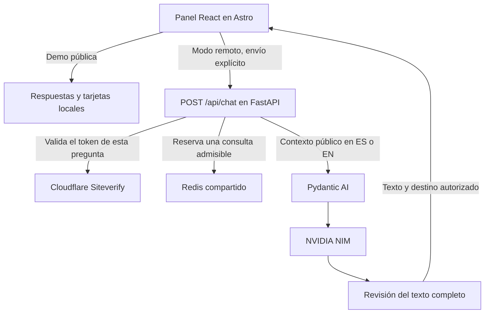

# Arquitectura y acceso al asistente

El escritorio usa el chat simulado por defecto. El modo remoto conecta el mismo chat a Pydantic AI y recibe el texto y los destinos del portfolio a través del protocolo de Vercel AI SDK.

Cada destino validado se muestra en el chat con una tarjeta del catálogo de json-render. Las rutas y etiquetas se resuelven en la web según el idioma activo.

## Arquitectura

Con la configuración predeterminada, React selecciona una respuesta bilingüe en el navegador. Abrir el panel o usar esa demo consume cero llamadas a NVIDIA. El modo remoto habilitado utiliza el mismo panel y envía únicamente las preguntas que el visitante decide enviar.



El contexto combina el perfil profesional y las fichas MDX del idioma activo. Se conserva en memoria por idioma dentro de cada instancia. El historial que llega del navegador se filtra y se entrega como datos de un turno de usuario. La única herramienta del modelo selecciona una de siete tarjetas internas; el frontend construye el enlace. El modelo no necesita acceso a datos privados. Sus acciones se limitan a la navegación interna.

Cada consulta admitida puede generar hasta dos peticiones al modelo si este selecciona una tarjeta. El máximo por petición es de 400 tokens de respuesta, con un límite de 800 por ejecución y un tiempo máximo de 20 segundos. La interfaz utiliza un protocolo de streaming, pero el visitante recibe el texto cuando el servidor ha terminado de revisarlo.

## Arranque local

En dos terminales, con Python 3.12 y Node 22:

```sh
PORTFOLIO_ASSISTANT_MODE=fixture uv run --with-requirements requirements.txt --with uvicorn \
  uvicorn api.chat:app --host 127.0.0.1 --port 8092
```

```sh
PUBLIC_PORTFOLIO_ASSISTANT_PREVIEW=1 PORTFOLIO_ASSISTANT_LOCAL_URL=http://127.0.0.1:8092 \
  pnpm dev --host 127.0.0.1 --port 4328
```

El modo `fixture` usa un modelo de prueba local con las mismas respuestas bilingües que la demo del navegador. Ambas las leen de `src/i18n/assistant-replies.json`, integrado en el diccionario `src/i18n/ui.ts`. Para probar Nemotron, guarda `NVIDIA_API_KEY` en el archivo local `.env.local`, excluido de Git. Usa el mismo servidor de Astro y cambia el comando de Python por el siguiente.

```sh
PORTFOLIO_ASSISTANT_MODE=live uv run --env-file .env.local --with-requirements requirements.txt --with uvicorn \
  uvicorn api.chat:app --host 127.0.0.1 --port 8092
```

Si cambias la URL del servidor local de Astro, define esa URL exacta en
`PORTFOLIO_ASSISTANT_LOCAL_ORIGIN` al arrancar Python.

## Vista previa de Vercel

Activa Vercel Authentication en Preview y usa la URL propia del despliegue indicada por `VERCEL_URL`. En Turnstile, autoriza ese hostname concreto en el widget gestionado. Cada envío se valida en el servidor para ese hostname y la acción `portfolio_chat`. Al crear otro despliegue cambia el hostname. [Configuración de hostnames](https://developers.cloudflare.com/turnstile/additional-configuration/hostname-management/) · [Validación en servidor](https://developers.cloudflare.com/turnstile/get-started/server-side-validation/)

| Variable                                                            | Uso                                                                                                                                                                                       |
| ------------------------------------------------------------------- | ----------------------------------------------------------------------------------------------------------------------------------------------------------------------------------------- |
| `PUBLIC_PORTFOLIO_ASSISTANT_PREVIEW`                                | Activa la interfaz remota de preview con el valor `1`.                                                                                                                                    |
| `PUBLIC_PORTFOLIO_TURNSTILE_SITE_KEY`                               | Clave pública del widget, disponible durante el build.                                                                                                                                    |
| `PORTFOLIO_ASSISTANT_MODE`                                          | El valor `live` habilita el proveedor en el servidor de preview.                                                                                                                          |
| `PORTFOLIO_TURNSTILE_SECRET_KEY`                                    | Secreto del widget, exclusivo del servidor.                                                                                                                                               |
| `PORTFOLIO_ASSISTANT_REDIS_URL` y `PORTFOLIO_ASSISTANT_REDIS_TOKEN` | Endpoint Redis REST por HTTPS y credencial con acceso a las operaciones de cuota. Usa un almacén persistente sin expulsión de claves y compártelo entre todas las instancias del entorno. |
| `NVIDIA_API_KEY`                                                    | Credencial del proveedor, exclusiva del servidor.                                                                                                                                         |

Configura las credenciales en el entorno Preview. La bandera de preview se ignora en Production. Al fallar la verificación o la reserva de cuota, el servidor cierra el acceso a la inferencia.

Pregunta «¿Qué aportó Alex al proyecto de IA médica?» en español y «What did Alex contribute to the medical AI project?» en inglés. Comprueba que la respuesta describe su trabajo en GLIO-IA y que el enlace abre la ficha en el idioma activo. Mide desde el envío hasta el primer texto visible y hasta el final de la respuesta.

## Activación pública

El despliegue público usa la demo local por defecto. Para permitir preguntas anónimas al modelo real, habilita el widget gestionado en `www.alejandromira.com`, configura los secretos de Turnstile, Redis y NVIDIA en Production y elige credenciales del proveedor adecuadas para uso público. Usa un almacén de cuota de producción separado del de pruebas. Los enlaces de otros dominios deben conducir a la URL canónica si quieres ofrecerles el chat remoto.

Activa `PORTFOLIO_ASSISTANT_MODE=live` en el servidor y `PORTFOLIO_ASSISTANT_PUBLIC_LIVE=1` en el build y en la función de Production. El build necesita también la clave pública del widget. El servidor comprueba el entorno, el dominio y la verificación de cada pregunta independientemente del estado del cliente. Antes de anunciarlo, valida un turno en español y otro en inglés, confirma la reserva en Redis y contrasta el número de turnos con el consumo de NVIDIA. Para volver a la demo, desactiva el modo público y vuelve a desplegar. Si necesitas cortar inmediatamente el acceso a un despliegue ya publicado, bloquea la ruta de chat en el firewall o revoca la credencial de inferencia del proveedor.

## Límites y seguridad

- El servidor valida el formato, el origen y el tamaño de la petición. El historial se pasa como datos sin privilegios, después de descartar turnos con contenido restringido. El modelo solo recibe referencias públicas del portfolio.
- Evita incluir datos privados al escribir. Se bloquean patrones de extracción de instrucciones y credenciales reconocibles antes de enviar la consulta a NVIDIA. Las reglas de texto reducen el riesgo y se combinan con herramientas de solo lectura.
- El servidor revisa la respuesta completa antes de mostrarla. El navegador recibe texto, una tarjeta opcional de una lista cerrada y un aviso genérico ante errores. Las trazas, el razonamiento y los parámetros internos del proveedor se descartan.
- El proceso limita los intentos antes de leer el cuerpo. Redis reserva los turnos que pueden llegar al proveedor con contadores compartidos. Los valores iniciales son 10 por cliente y minuto, 30 globales por minuto y 100 globales en 24 horas. Se ajustan con `PORTFOLIO_ASSISTANT_CLIENT_PER_MINUTE`, `PORTFOLIO_ASSISTANT_GLOBAL_PER_MINUTE` y `PORTFOLIO_ASSISTANT_GLOBAL_PER_DAY`. El contador mide turnos admitidos, no tokens ni importe facturado.
- Para una apertura anónima, la verificación de navegador reduce la automatización y el cupo global limita su coste residual. Para restringir el uso a personas identificadas se necesita además autenticación. El portal público puede seguir usando la demo local mientras se toma esa decisión.

## Oportunidades de optimización

Las tres preguntas sugeridas tienen respuestas editoriales y destinos conocidos. Resolverlas localmente también en el modo remoto permitiría ahorrar la verificación y la inferencia en esos turnos. Para preguntas libres, conviene medir si una única respuesta estructurada con texto y destino conserva la calidad bilingüe y evita la segunda petición al modelo. La métrica relevante es el tiempo desde el envío hasta la respuesta ya revisada, junto con las llamadas reales por turno.

## Pruebas

Las pruebas de concurrencia y caducidad de la cuota arrancan un Redis temporal con un socket local. Para ejecutarlas se necesitan `redis-server` y `redis-cli` en el PATH. Siteverify y NVIDIA se simulan durante las pruebas automáticas.

```sh
uv run --with-requirements requirements.txt --with pytest --with httpx python -m pytest -q tests
```
