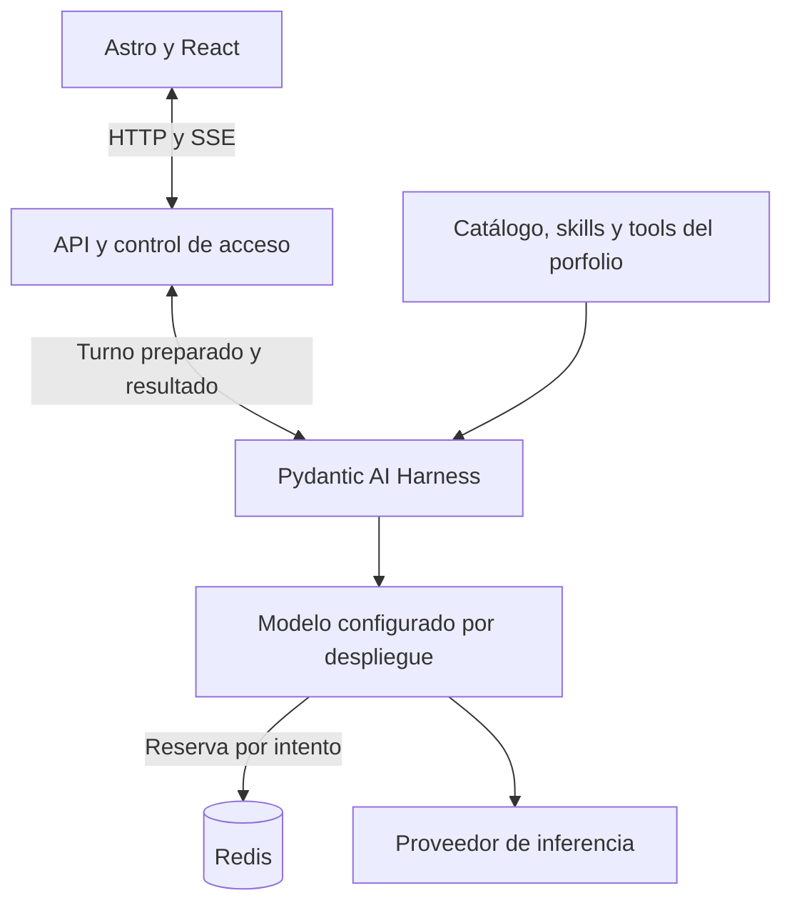

# Arquitectura y acceso al asistente

El escritorio usa el chat simulado por defecto. El modo remoto conecta el mismo chat a Pydantic AI y recibe el texto y los destinos del portfolio a través del protocolo de Vercel AI SDK.

Cada destino validado se muestra en el chat con una tarjeta del catálogo de json-render. Las rutas y etiquetas se resuelven en la web según el idioma activo.

## Arquitectura

Con la configuración predeterminada, React selecciona una respuesta bilingüe en el navegador. Abrir el panel o usar esa demo consume cero llamadas a NVIDIA. El modo remoto habilitado utiliza el mismo panel y envía únicamente las preguntas que el visitante decide enviar.



La definición del porfolio vive en `server/portfolio_guide.py`. Durante el build, `pnpm run assistant:catalog` genera el catálogo bilingüe versionado en `server/assistant_catalog.json` a partir de los MDX publicados y del contenido compartido del perfil. La guía selecciona evidencia, instrucciones, funciones de lectura y un destino. El harness recibe ese turno y un modelo de Pydantic AI. Los identificadores de las fuentes sirven para revisar la evidencia. React resuelve los enlaces según el idioma.

Las instrucciones de las skills forman el prefijo del prompt. La pregunta, el historial reciente y los fragmentos de evidencia se envían después. Las peticiones que seleccionan las mismas skills pueden así reutilizar prefijos en los proveedores que admiten caché automática. El ensayo mide tokens de entrada y salida. No mide aciertos de caché ni ahorro facturado.

Los botones CV, experiencia y GLIO-IA y las consultas de datos exactos se resuelven en el servidor sin inferencia. Las preguntas de aportación sobre Cookobot, las comparaciones de sus contribuciones y la recomendación general de dos casos de visión artificial citan las fichas en el idioma del visitante. Otras comparaciones de proyectos nombrados ejecutan el script revisado de la skill y entregan las contribuciones al modelo en una petición. La API sirve las preguntas compuestas en una sola síntesis. Code Mode se puede probar únicamente desde el evaluador local con `--compound`. Monty puede agrupar hasta tres lecturas del catálogo en una ejecución. Una segunda inferencia redacta la respuesta. El proceso impone un plazo total de 20 segundos. El servidor examina la respuesta completa antes de publicar el texto o la tarjeta.

Elige el proveedor con `PORTFOLIO_ASSISTANT_PROVIDER` y el modelo con `PORTFOLIO_ASSISTANT_MODEL`. NVIDIA usa Nemotron por defecto. Para los demás proveedores hace falta indicar un modelo compatible con el uso previsto.

| Proveedor | Credencial |
| --- | --- |
| `nvidia` | `NVIDIA_API_KEY` |
| `openai` | `OPENAI_API_KEY` |
| `anthropic` | `ANTHROPIC_API_KEY` |
| `openrouter` | `OPENROUTER_API_KEY` |

## Arranque local

En dos terminales, con Python 3.12 y Node 22:

```sh
PORTFOLIO_ASSISTANT_MODE=fixture uv run --with-requirements requirements.txt --with uvicorn \
  uvicorn api.chat:app --host 127.0.0.1 --port 8092
```

```sh
PUBLIC_PORTFOLIO_ASSISTANT_PREVIEW=1 PORTFOLIO_ASSISTANT_LOCAL_URL=http://127.0.0.1:8092 \
  pnpm dev --host 127.0.0.1 --port 4328
```

El modo `fixture` usa un modelo de prueba local con las mismas respuestas bilingües que la demo del navegador. Ambas las leen de `src/i18n/assistant-replies.json`, integrado en el diccionario `src/i18n/ui.ts`. Para probar Nemotron, guarda `NVIDIA_API_KEY` en el archivo local `.env.local`, excluido de Git. Usa el mismo servidor de Astro y cambia el comando de Python por el siguiente.

```sh
PORTFOLIO_ASSISTANT_MODE=live uv run --env-file .env.local --with-requirements requirements.txt --with uvicorn \
  uvicorn api.chat:app --host 127.0.0.1 --port 8092
```

Si cambias la URL del servidor local de Astro, define esa URL exacta en
`PORTFOLIO_ASSISTANT_LOCAL_ORIGIN` al arrancar Python.

## Vista previa de Vercel

Activa Vercel Authentication en Preview y usa la URL propia del despliegue indicada por `VERCEL_URL`. En Turnstile, autoriza ese hostname concreto en el widget gestionado. Cada envío se valida en el servidor para ese hostname y la acción `portfolio_chat`. Al crear otro despliegue cambia el hostname. [Configuración de hostnames](https://developers.cloudflare.com/turnstile/additional-configuration/hostname-management/) · [Validación en servidor](https://developers.cloudflare.com/turnstile/get-started/server-side-validation/)

| Variable                                                            | Uso                                                                                                                                                                                       |
| ------------------------------------------------------------------- | ----------------------------------------------------------------------------------------------------------------------------------------------------------------------------------------- |
| `PUBLIC_PORTFOLIO_ASSISTANT_PREVIEW`                                | Activa la interfaz remota de preview con el valor `1`.                                                                                                                                    |
| `PUBLIC_PORTFOLIO_TURNSTILE_SITE_KEY`                               | Clave pública del widget, disponible durante el build.                                                                                                                                    |
| `PORTFOLIO_ASSISTANT_MODE`                                          | El valor `live` habilita el proveedor en el servidor de preview.                                                                                                                          |
| `PORTFOLIO_TURNSTILE_SECRET_KEY`                                    | Secreto del widget, exclusivo del servidor.                                                                                                                                               |
| `PORTFOLIO_ASSISTANT_REDIS_URL` y `PORTFOLIO_ASSISTANT_REDIS_TOKEN` | Endpoint Redis REST por HTTPS y credencial con acceso a las operaciones de cuota. Usa un almacén persistente sin expulsión de claves y compártelo entre todas las instancias del entorno. |
| `NVIDIA_API_KEY`                                                    | Credencial del proveedor, exclusiva del servidor.                                                                                                                                         |

Configura las credenciales en el entorno Preview. La bandera de preview se ignora en Production. Al fallar la verificación o la reserva de cuota, el servidor cierra el acceso a la inferencia.

Pregunta «¿Qué aportó Alex al proyecto de IA médica?» en español y «What did Alex contribute to the medical AI project?» en inglés. Comprueba que la respuesta describe su trabajo en GLIO-IA y que el enlace abre la ficha en el idioma activo. Mide desde el envío hasta el primer texto visible y hasta el final de la respuesta.

## Activación pública

El despliegue público usa la demo local por defecto. Para permitir preguntas anónimas al modelo real, habilita el widget gestionado en `www.alejandromira.com`, configura los secretos de Turnstile, Redis y NVIDIA en Production y elige credenciales del proveedor adecuadas para uso público. Usa un almacén de cuota de producción separado del de pruebas. Los enlaces de otros dominios deben conducir a la URL canónica si quieres ofrecerles el chat remoto.

Activa `PORTFOLIO_ASSISTANT_MODE=live` en el servidor y `PORTFOLIO_ASSISTANT_PUBLIC_LIVE=1` en el build y en la función de Production. El build necesita también la clave pública del widget. El servidor comprueba el entorno, el dominio y la verificación de cada pregunta independientemente del estado del cliente. Antes de anunciarlo, valida un turno en español y otro en inglés, comprueba que las respuestas editoriales consumen cero y contrasta los intentos de inferencia con Redis. Para volver a la demo, desactiva el modo público y vuelve a desplegar. Si necesitas cortar inmediatamente el acceso a un despliegue ya publicado, bloquea la ruta de chat en el firewall o revoca la credencial de inferencia del proveedor.

## Límites y seguridad

- El servidor valida el formato, el origen y el tamaño de la petición. El historial se pasa como datos sin privilegios, después de descartar turnos con contenido restringido. El modelo solo recibe referencias públicas del portfolio.
- Evita incluir datos privados al escribir. Se bloquean patrones de extracción de instrucciones y credenciales reconocibles antes de enviar la consulta a NVIDIA. Las reglas de texto reducen el riesgo y se combinan con herramientas de solo lectura.
- El servidor revisa la respuesta completa antes de mostrarla. El navegador recibe texto, una tarjeta opcional de una lista cerrada y un aviso genérico ante errores. Las trazas, el razonamiento y los parámetros internos del proveedor se descartan.
- El proceso limita los intentos antes de leer el cuerpo. Redis reserva cada intento HTTP de inferencia con contadores compartidos. Los valores iniciales son 10 por cliente y minuto, 30 globales por minuto y 100 globales en 24 horas. Se ajustan con `PORTFOLIO_ASSISTANT_CLIENT_PER_MINUTE`, `PORTFOLIO_ASSISTANT_GLOBAL_PER_MINUTE` y `PORTFOLIO_ASSISTANT_GLOBAL_PER_DAY`. Una síntesis consume una unidad y un turno de dos inferencias consume dos. Las consultas editoriales consumen cero.
- Para una apertura anónima, la verificación de navegador reduce la automatización y el cupo global limita su coste residual. Para restringir el uso a personas identificadas se necesita además autenticación. El portal público puede seguir usando la demo local mientras se toma esa decisión.

## Evaluación y publicación de skills

Las revisiones de `assistant_skills/` se publican con Git. Cada cambio de procedimiento o script incluye un caso reproducible en ES y EN, comprueba el catálogo y se revisa por PR a `develop`. La revisión aprobada queda fijada por el commit del despliegue. Para recuperar una versión funcional, vuelve a desplegar el commit verificado junto con su catálogo.

La suite Python comprueba rutas, permisos, evidencia, presupuestos y comportamiento del sandbox con modelos simulados. Para evaluar calidad real, ejecuta las preguntas públicas de `tests/evals/assistant.json` en un entorno con una credencial de evaluación. Los siguientes comandos envían peticiones al proveedor configurado. Cada ejecución tiene su propio tope de intentos.

```sh
python -m scripts.evaluate_assistant --max-posts 8 --output /tmp/assistant-base.json
python -m scripts.evaluate_assistant --compound --max-posts 8 --baseline /tmp/assistant-base.json --output /tmp/assistant-candidate.json
```

Los informes incluyen el modelo, las versiones de catálogo, skills y casos, y las respuestas a preguntas de prueba. Compara los intentos, los tokens del turno y su duración. Revisa las afirmaciones y fuentes en ambos idiomas antes de aprobar una candidata. Los fallos por cuota y los errores temporales del proveedor se investigan por separado de un defecto de la skill. El coste facturado y los aciertos de caché dependen del proveedor.

En el ensayo local con Nemotron, el flujo ordinario superó los diez casos ES/EN con cuatro peticiones en total. Seis consultas se resolvieron sin inferencia. Al revisar el texto en español se encontró una atribución imprecisa: una respuesta decía que Alex desarrolló los modelos TensorFlow de Cookobot, mientras la ficha documenta su integración y optimización. Los criterios automáticos de esa tanda comprobaban nombres de proyectos, datos concretos, destinos y consumo. El banco de pruebas actual incluye el error observado y su equivalente en inglés. Comprueba la integración y optimización de los modelos y distingue ese trabajo del desarrollo de la interfaz. La candidata con Code Mode superó nueve casos con cinco peticiones. En la recomendación inglesa, dos ensayos dirigidos posteriores produjeron una salida truncada y una llamada a herramienta escrita como texto. El harness descarta ambos resultados. Code Mode queda desactivado en la API de todos los entornos.

## Pruebas

Las pruebas de concurrencia y caducidad de la cuota arrancan un Redis temporal con un socket local. Para ejecutarlas se necesitan `redis-server` y `redis-cli` en el PATH. Siteverify y NVIDIA se simulan durante las pruebas automáticas.

```sh
uv run --with-requirements requirements.txt --with pytest --with httpx python -m pytest -q tests
```

Para recorrer el transporte de React hasta la API Python y verificar los destinos de ambos idiomas, instala `uvicorn` en el entorno Python activo y ejecuta:

```sh
pnpm exec playwright test --config playwright.assistant.config.ts
```
